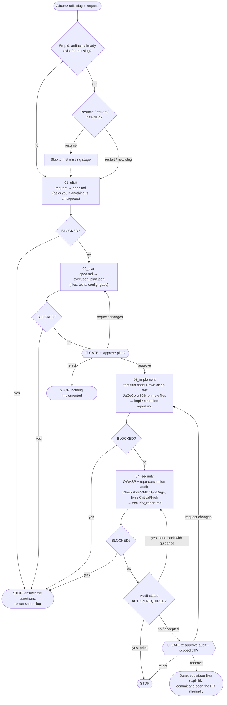
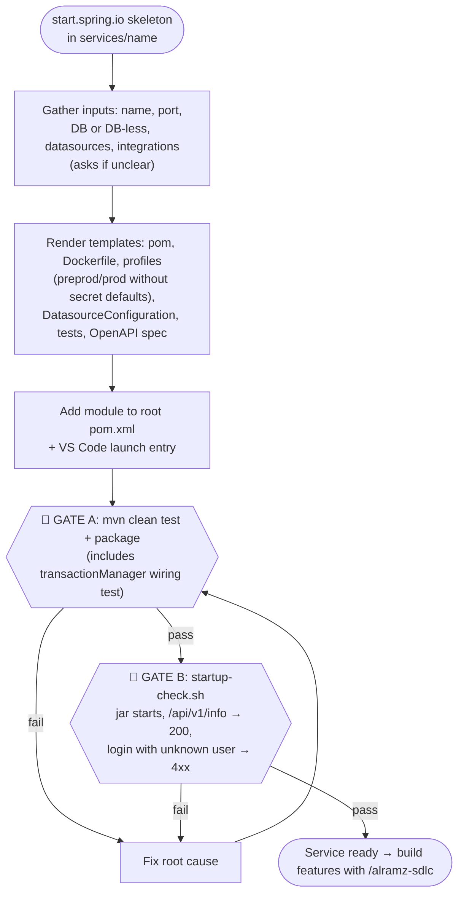
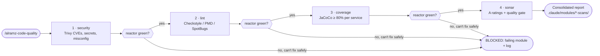

# Al Ramz Middleware & Infrastructure

Java/Spring Boot microservices (payload validation, reference data, notifications) plus the
Terraform + Kubernetes IaC that deploys them to Azure, in one Maven-reactor monorepo.

## Services

| Module | What it does |
|---|---|
| [`alramz-common-bom`](services/alramz-common-bom) | Parent POM + dependency BOM + shared plugin config — every other module inherits from it |
| [`alramz-api-starter`](services/alramz-api-starter) | Shared Spring Boot auto-config starter (library, not a runnable app): JWT auth, multi-datasource, scheduler, request/DB audit logging, feature flags |
| [`onboarding-service`](services/onboarding-service) | Onboarding: IBAN/phone validation, bank info lookup, DFM investor onboarding |
| [`alramz-notification-service`](services/alramz-notification-service) | Email/notification delivery via MS Graph and Azure Service Bus |
| [`reference-data-service`](services/reference-data-service) | Reference/global-config data, backed by Redis cache |
| [`utility-service`](services/utility-service) | Shared utility APIs (community posts) |
| [`reporting-management-service`](services/reporting-management-service) | Reporting: relationship managers and their commissions |
| [`wealth-management-service`](services/wealth-management-service) | Wealth management: MMF accounts, sweep-ins/outs, custodian cash and positions, profit distributions |
| [`risk-management-service`](services/risk-management-service) | Risk compliance: countries and country risk ratings from the KnowYourCountry vendor |

## Dev Profile Services

Ports from each service's `application-dev.yml` (run with `-Dspring-boot.run.profiles=dev`).

| Service | Description | Port | Info endpoint |
|---|---|---|---|
| `onboarding-service` | Onboarding: IBAN validation and bank info lookup | 8080 | http://localhost:8080/actuator/info |
| `reference-data-service` | Reference/global-config data, backed by Redis cache | 8081 | http://localhost:8081/actuator/info |
| `alramz-notification-service` | Email/notification delivery via MS Graph | 8082 | http://localhost:8082/actuator/info |
| `utility-service` | Shared utility APIs | 8083 | http://localhost:8083/actuator/info |
| `reporting-management-service` | Reporting management | 8084 | http://localhost:8084/actuator/info |
| `wealth-management-service` | Wealth management | 8085 | http://localhost:8085/actuator/info |
| `risk-management-service` | Risk compliance (KnowYourCountry countries/ratings) | 8086 | http://localhost:8086/actuator/info |

## Repository Layout

```
services/   Maven-reactor modules listed above
infra/      Terraform: modules/, stacks/<env>/, environments/<env>.tfvars
k8s/        Kustomize base + overlays/<env>, environments/<env> (namespace manifests), argocd/
.github/    workflows/, composite actions/, service-deployment-catalogue/, SECRETS.md
config/     Shared checkstyle.xml, pmd.xml, spotbugs-exclude.xml
release/    docker-compose.yml, .env.example, release.sh
```

## Build & Run

New to the repo? Follow [`DEVELOPER_GUIDELINES.md`](DEVELOPER_GUIDELINES.md) first.

Run Maven from the **repo root** — the reactor resolves `alramz-common-bom`/`alramz-api-starter`
without needing GitHub Packages auth.

```bash
mvn -pl services/<service> -am clean test          # build/test one service
mvn -pl services/<service> -am clean test-compile  # fast compile check
cd services/onboarding-service && ./mvnw spring-boot:run
```

Full CLI reference: [`docs/COMMANDS.md`](docs/COMMANDS.md). Local Postgres/Redis/Seq stack:
[`release/README.md`](release/README.md) and [`docs/LOCAL-SETUP.md`](docs/LOCAL-SETUP.md).

## Infrastructure & Deployment

- **Terraform** (`infra/`) provisions Azure resources per environment (dev/qa/preprod/prod/
  shared-platform). Only `infra/stacks/dev` is for routine iteration.
- **Kubernetes** (`k8s/`) — Kustomize base + environment overlays, delivered via ArgoCD. See
  [`k8s/README.md`](k8s/README.md).
- **CI/CD** — GitHub Actions in `.github/workflows/`, path-filtered per changed service, builds
  and pushes images to ACR.

## Claude Code Skills & Commands

This repo ships its own Claude Code automation in `.claude/`. Setup and prompting tips:
[`DEVELOPER_GUIDELINES.md`](DEVELOPER_GUIDELINES.md).

### What is a skill?

A **skill** is a folder in `.claude/skills/<name>/` with a `SKILL.md` that holds step-by-step
instructions for one kind of task. Some skills also ship templates or scripts. Claude loads a
skill in two ways:

- **Explicitly**: type `/<skill-name> <your request>`, e.g. `/alramz-service-scaffold create payments-service`.
- **Automatically**: describe the task in plain words ("scan for vulnerabilities") and Claude
  picks the matching skill from its description.

A **command** (`.claude/commands/*.md`) is a slash command that orchestrates work, usually by
running **agents** (`.claude/agents/*.md`). Each agent is a sub-session with its own instructions
and a restricted tool set, so a stage only does its own job.

| Type | Name | Use it to |
|---|---|---|
| Command | `/alramz-sdlc <feature-slug> <request>` | Take a feature from requirement to reviewed code, with 2 approval gates |
| Command | `/alramz-code-quality [all\|security\|lint\|coverage\|sonar] [services: a,b]` | Run a full or partial code-quality pass |
| Skill | `/alramz-service-scaffold` | Create a new service under `services/`, then prove it builds, tests and starts |
| Skill | `/endpoint-intake-extraction` | Turn a legacy (e.g. webMethods) endpoint doc into a structured feature request |
| Skill | `/alramz-e2e-api-tests-generator` | Generate Postman requests and tests from a service's OpenAPI spec |
| Skill | `/alramz-security-vuln-fixer` | Run a Trivy scan (CVEs, secrets, misconfig) and fix findings |
| Skill | `/alramz-static-analysis-fixer` | Fix Checkstyle, PMD and SpotBugs violations |
| Skill | `/alramz-jacoco-coverage-check` | Raise every service to the 80% line-coverage gate |
| Skill | `/alramz-sonar-remediation` | Fix SonarCloud issues until ratings are A and the quality gate passes |
| Skill | `/user-story-writer` | Write BA/PM user stories and specs |
| Skill | `/spring-boot-testing` | Pick the right Spring Boot test technique (the pipeline uses it) |

None of these commit, push or open PRs. You review the working tree and commit it yourself.

### `/alramz-sdlc` — feature pipeline

```
/alramz-sdlc risk-compilance-endpoints Focus exclusively on the Risk Management Service. ... If anything is unclear or missing, ask specific clarification questions and proceed.
```

Paste the requirement source (legacy doc, BA notes, samples) along with the request. Artifacts
are written to `.claude/modules/features/<feature-slug>/`. Re-running with the same slug resumes
from the last stage that finished.



| Stage | Reads | Writes | Your role |
|---|---|---|---|
| `01_elicit` | your request, repo code, howtos | `spec.md` | Answer clarifying questions |
| `02_plan` | `spec.md` | `execution_plan.json` | **Gate 1:** approve, request changes or reject |
| `03_implement` | spec + plan | code, tests, `implementation-report.md` | Answer if the plan conflicts with the code |
| `04_security` | the working-tree diff | fixes, `security_report.md` | **Gate 2:** approve, request changes or reject |

`BLOCKED` is a hard stop, not a gate: the pipeline shows you the question and ends. Answer it,
then re-run with the same slug.

### `/alramz-service-scaffold` — new service

Generate the skeleton on start.spring.io, unzip it into `services/`, then run:

```
/alramz-service-scaffold Use the skill to create a new <name>-service within the existing maven monorepo, following established architectural and coding conventions.
```



### `/alramz-code-quality` — quality pass

```
/alramz-code-quality all
/alramz-code-quality lint coverage services: risk-management-service
```



Steps you didn't ask for are skipped, but the order never changes. It asks you before any
decision that changes auth behaviour, environment variables, major dependency versions or rule
exclusions.

## Documentation Map

- [`DEVELOPER_GUIDELINES.md`](DEVELOPER_GUIDELINES.md) — **start here**: local setup, installing Claude Code, creating a new service and prompting the Claude skills
- [`CLAUDE.md`](CLAUDE.md) / [`AGENTS.md`](AGENTS.md) — operational rules for AI coding agents working in this repo
- [`docs/codebase/`](docs/codebase) — stack, architecture, structure, conventions, integrations, testing, known concerns
- [`docs/COMMANDS.md`](docs/COMMANDS.md) — full CLI command reference
- [`.claude/howtos/`](.claude/howtos/README.md) — subsystem how-tos (JWT, datasource, Liquibase, masking, secrets)
